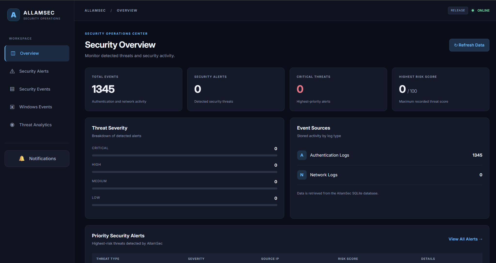

# AllamSec

### Windows Security Monitoring & Threat Detection Platform

**Version 1.1.0**

[](https://github.com/KareemAllam123/AllamSec/actions/workflows/tests.yml)
[](https://github.com/KareemAllam123/AllamSec/releases)


AllamSec is a Python-based cybersecurity monitoring platform designed to collect Windows Security events, analyze authentication activity, identify suspicious behavior, and visualize security findings through a local web dashboard.

Developed as an independent cybersecurity project, AllamSec demonstrates practical Security Operations Center (SOC) concepts, including log collection, threat detection, event correlation, risk scoring, alert investigation, and security visualization.
## Key Features

### Windows Security Event Monitoring

- Collects authentication-related events from Windows Security logs.
- Supports continuous monitoring with configurable collection intervals.
- Uses checkpoints to track collection progress and avoid reprocessing previously collected events.
- Stores security events in a local SQLite database.
- Processes event batches for ongoing monitoring.

### Threat Detection

- Detects repeated failed authentication attempts.
- Identifies potentially suspicious successful logins following repeated failures.
- Supports configurable detection thresholds and time windows.
- Includes network event parsing and port-scan detection capabilities.
- Correlates relevant security events to generate alerts.

### Risk Scoring and Alert Management

- Assigns risk scores and severity classifications to detected threats.
- Stores alerts for investigation.
- Supports alert status updates and investigation notes.
- Distinguishes suspicious activity from confirmed compromise.

### Security Dashboard

- Local browser-based dashboard powered by Flask and Waitress.
- Security overview and event statistics.
- Windows Security event viewer.
- Security alert management.
- Threat analytics and visualizations.
- Notification Center.

### Notifications

- Generates notification previews for detected threats.
- Supports configurable notification severity thresholds.
- Keeps email delivery disabled by default.

### Windows Application Packaging

Version 1.1.0 introduces:

- PyInstaller configuration for building a standalone Windows executable.
- Inno Setup configuration for creating a Windows installer.
- Packaged execution support for the dashboard and Windows monitoring components.
- Centralized application filesystem paths.
- Writable application data storage under `%LOCALAPPDATA%\AllamSec`.

**Packaging limitation:** The installer and portable executable are currently unsigned. Windows Smart App Control has blocked execution of these binaries during testing. They are not yet verified for general public distribution. Do not disable Windows security protections to run them.

### Automated Testing and Continuous Integration

- 241 automated tests passing, plus 2 passing subtests.
- Tests cover event parsing, threat detection, database operations, and other application functionality.
- GitHub Actions automatically runs tests on Windows when changes are pushed or pull requests are opened, according to the workflow configuration.
- CI provides visibility into test results and helps detect regressions.

## Technologies

| Category | Technologies |
|---|---|
| Programming | Python |
| Backend | Flask, Waitress |
| Database | SQLite |
| Frontend | HTML, CSS, JavaScript |
| Security | Windows Security Event Logs |
| Testing | pytest, unittest, GitHub Actions |
| Packaging | PyInstaller, Inno Setup |
| Version Control | Git, GitHub |

## Installation

### Requirements

- Windows 10 or Windows 11
- Python 3
- Internet connection for installing dependencies
- Appropriate Windows event-log permissions for live monitoring

The Python-based installation remains the recommended method while the Windows binaries are undergoing trust and signing verification.

Download the source code from the latest release:

https://github.com/KareemAllam123/AllamSec/releases

Alternatively, clone the repository:

```powershell
git clone https://github.com/KareemAllam123/AllamSec.git
cd AllamSec
```

### Install Using PowerShell

Open PowerShell inside the AllamSec directory and run:

```powershell
py -3 -m venv .venv
.\.venv\Scripts\python.exe -m pip install -r requirements.txt
.\.venv\Scripts\python.exe -c "from database.db_manager import initialize_database; initialize_database()"
```

The `setup.bat` installation helper is also available on systems where Windows permits its execution.

For additional installation instructions and troubleshooting, see [INSTALL.md](INSTALL.md).

## Running AllamSec

### Combined Dashboard and Windows Monitor

From the AllamSec directory, run:

```powershell
.\.venv\Scripts\python.exe start_allamsec.py
```

The launcher:

1. Starts the local security dashboard.
2. Checks administrator permissions.
3. Starts continuous Windows Security monitoring when administrator privileges are available.
4. Opens the dashboard in your browser.

**Dashboard:** http://127.0.0.1:5000

For live Windows Security monitoring, launch PowerShell as Administrator before running the command.

Without administrator privileges, the dashboard can still operate, but the combined launcher skips Windows monitoring.

### Starting Components Individually

Start the dashboard:

```powershell
.\.venv\Scripts\python.exe -m dashboard.server
```

Start Windows monitoring:

```powershell
.\.venv\Scripts\python.exe -m app.monitor_launcher
```

Press `Ctrl+C` to stop the application.

## Configuration

AllamSec uses `config.json` to configure monitoring and detection behavior.

| Setting | Default |
|---|---|
| Monitoring interval | 60 seconds |
| Maximum events per batch | 500 |
| Failed login threshold | 5 |
| Detection window | 60 seconds |
| Minimum notification severity | HIGH |
| Email notifications | Disabled |
| Dashboard address | 127.0.0.1:5000 |

For packaged builds, application data is stored under:

```text
%LOCALAPPDATA%\AllamSec
```

This separates writable security data from the application installation directory.

## Detection Examples

### Possible Brute-Force Attack

Five failed authentication attempts within the configured 60-second window can trigger a HIGH-severity alert when the detection rule's correlation conditions are satisfied.

### Possible Account Compromise

A successful authentication following repeated failed attempts can trigger a CRITICAL-severity alert when it meets the detection criteria.

These alerts identify potentially suspicious behavior. They do not independently establish that an account has been compromised.

## Running Tests

Install pytest if necessary:

```powershell
python -m pip install pytest
```

Run the automated test suite:

```powershell
python -m pytest -q
```

**Latest verified local result:**

```text
241 passed, 2 subtests passed
```

### GitHub Actions

AllamSec uses GitHub Actions for automated testing.

The workflow is defined in:

```text
.github/workflows/tests.yml
```

The workflow uses a Windows runner, installs Python and project dependencies, and executes the automated test suite.

View the workflow results:

https://github.com/KareemAllam123/AllamSec/actions

## Project Structure

```text
AllamSec/
|-- .github/
|   |-- workflows/
|       |-- tests.yml
|-- app/                  # Application and Windows monitoring
|   |-- paths.py          # Centralized filesystem paths
|-- dashboard/            # Web dashboard and static assets
|-- database/             # SQLite database management
|-- detection/            # Threat detection modules
|-- tests/                # Automated tests
|-- tools/                # Release and development utilities
|-- AllamSec.spec         # PyInstaller build configuration
|-- AllamSec-Setup.iss    # Inno Setup installer configuration
|-- config.json           # Application configuration
|-- INSTALL.md            # Detailed installation instructions
|-- README.md
|-- requirements.txt
|-- setup.bat
|-- start_allamsec.py     # Combined application launcher
|-- start_allamsec.bat    # Dashboard-only launcher
|-- start_monitor.bat     # Monitor-only launcher
```

## Security Considerations

AllamSec is an educational and defensive security monitoring project.

- Only monitor systems and logs you are authorized to access.
- Keep the dashboard bound to the local loopback address.
- Do not expose the dashboard directly to the internet.
- Do not disable Windows security protections to install AllamSec.
- Use administrator privileges only when required.
- Review alerts before drawing conclusions about suspicious activity.
- Treat detected threats as indicators requiring investigation.

AllamSec is not a replacement for enterprise SIEM platforms, endpoint detection solutions, or professional incident response services.

## Release History

### v1.1.0 — Windows Packaging Support

- Added Windows executable and installer build configurations.
- Updated the application launcher for packaged execution.
- Introduced centralized filesystem path management.
- Added persistent application data storage for packaged builds.
- Updated application version information.
- Added GitHub Actions automated testing.

**Known limitation:** Unsigned Windows binaries may be blocked by Windows application-control policies.

### v1.0.1 — Installation and Startup Improvements

- Improved installation documentation.
- Introduced a combined dashboard and Windows monitoring launcher.
- Updated dashboard version information.

### v1.0.0 — Initial Release

- Established the initial AllamSec release.

## Development Status

AllamSec is under active development.

Future improvements may include expanded threat detection, enhanced alert investigation workflows, improved Windows distribution, and additional security analytics.

## Disclaimer

AllamSec is intended for educational use, authorized security monitoring, and cybersecurity research.

Users are responsible for complying with applicable laws, organizational policies, and system access requirements.

## Dashboard Preview

AllamSec provides a local security operations dashboard for monitoring Windows Security events, reviewing detected threats, and investigating suspicious activity.

*AllamSec Security Overview displaying collected authentication events, threat severity, and security monitoring statistics.*